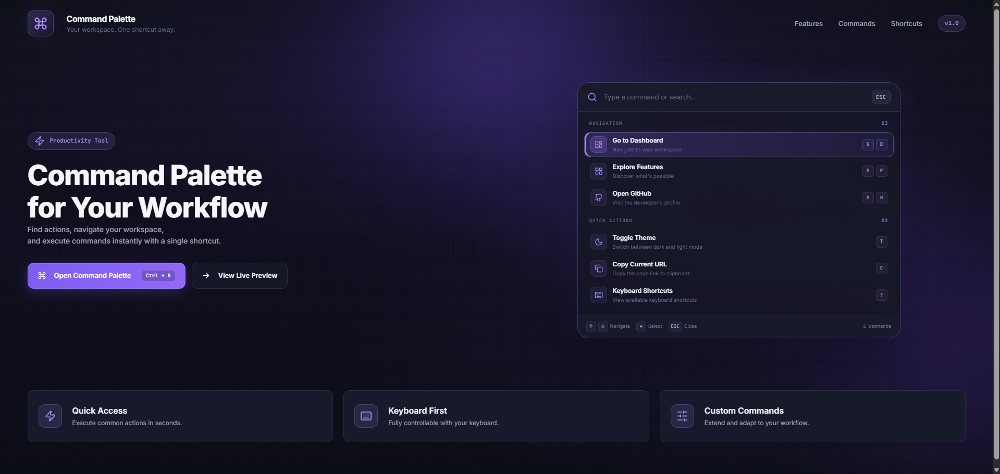

# Command Palette PRO

A modern, responsive and interactive command palette built with **HTML, CSS and Vanilla JavaScript**.

Command Palette PRO provides a fast way to navigate a website, execute actions, search commands and interact with the interface using keyboard shortcuts.

## 🌐 Live Demo

🚀 **[View Live Demo](https://johnyisbackk.github.io/js-command-palette/)**

## 🖼️ Preview



## ✨ Features

- **Interactive Command Palette** – Open and close a modal-based command interface.
- **Live Search** – Filter available commands instantly by title or description.
- **Keyboard Navigation** – Navigate commands using ArrowUp and ArrowDown.
- **Cyclic Navigation** – Automatically move between the first and last commands.
- **Keyboard Shortcuts** – Execute actions using customizable key sequences.
- **Command Execution** – Navigate to sections, open external links and perform quick actions.
- **Dark / Light Mode** – Switch between themes with persistent preferences.
- **LocalStorage Support** – Save and restore the selected theme.
- **Copy URL** – Copy the current page URL using the Clipboard API.
- **Responsive Design** – Optimized for desktop, tablet and mobile devices.
- **Lucide Icons** – Modern and consistent iconography.

## ⌨️ Keyboard Shortcuts

| Shortcut               | Action                   |
| ---------------------- | ------------------------ |
| `Ctrl + K` / `Cmd + K` | Open Command Palette     |
| `ArrowDown`            | Select next command      |
| `ArrowUp`              | Select previous command  |
| `Enter`                | Execute selected command |
| `Escape`               | Close Command Palette    |
| `G` → `D`              | Go to Dashboard          |
| `G` → `F`              | Explore Features         |
| `G` → `H`              | Open GitHub              |
| `T`                    | Toggle Theme             |
| `C`                    | Copy Current URL         |
| `?`                    | Show Keyboard Shortcuts  |

_Single-letter shortcuts work when the command palette is closed and focus is outside editable fields. The G shortcuts are sequential key presses._

## 🛠️ Technologies Used

- HTML5
- CSS3
- Vanilla JavaScript (ES6+)
- DOM Manipulation
- LocalStorage API
- Clipboard API
- HTML Dialog API
- Lucide Icons

## 🧠 JavaScript Concepts

This project demonstrates practical knowledge of:

- Event listeners and event delegation
- State management
- Dynamic HTML rendering
- Array methods: `filter()`, `map()` and `forEach()`
- Conditional rendering
- Keyboard event handling
- DOM selection and manipulation
- Browser APIs
- Asynchronous JavaScript with `async/await`
- Persistent user preferences

## 🚀 Getting Started

1. Clone the repository:

   ```bash
   git clone https://github.com/JohnyIsBackk/command-palette-pro.git
   ```

2. Open the project directory.

3. Launch `index.html` in your browser, or use the Live Server extension in Visual Studio Code.

No build tools or frameworks are required.

## 🎯 Project Purpose

Command Palette PRO was developed as a frontend portfolio project to strengthen practical JavaScript skills, particularly state management, keyboard interactions, dynamic rendering and browser APIs.

The project focuses on writing structured, maintainable Vanilla JavaScript without relying on frontend frameworks.

## 👨‍💻 Author

**Samuel Jahn**

Frontend Developer

- Portfolio: https://samueljahn.sk
- GitHub: https://github.com/JohnyIsBackk

## 📄 License

This project is licensed under the MIT License. See the `LICENSE` file for details.
